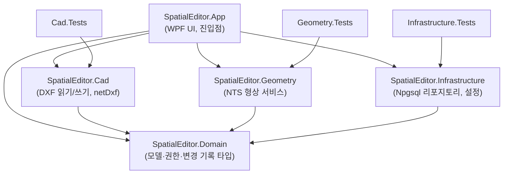
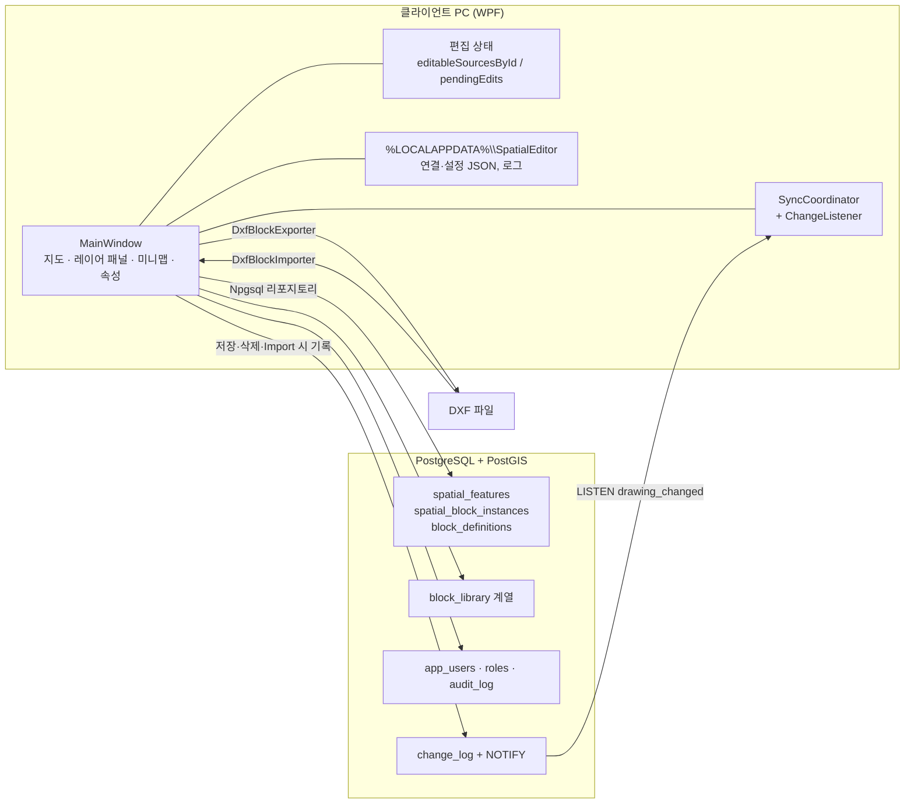
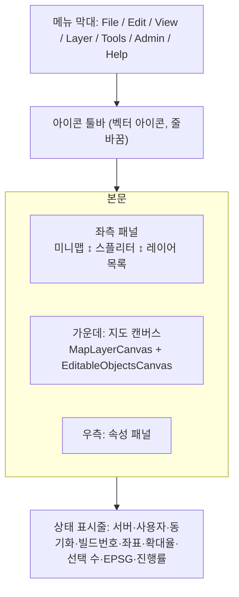
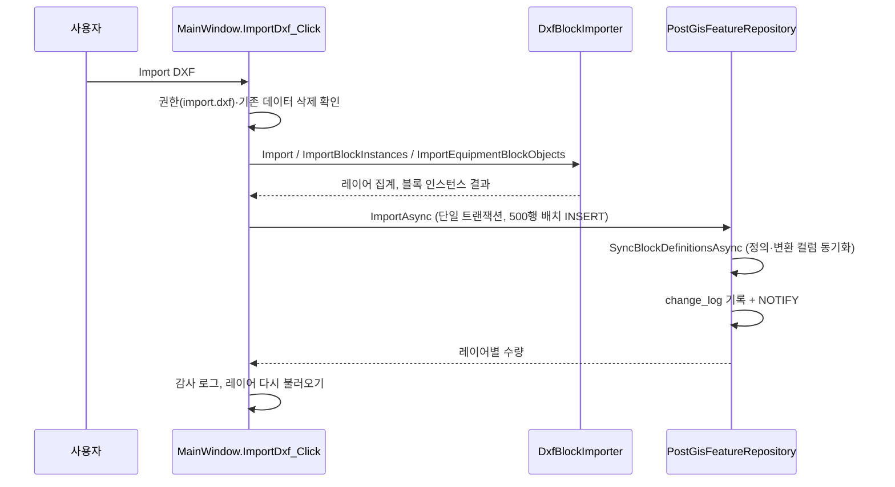
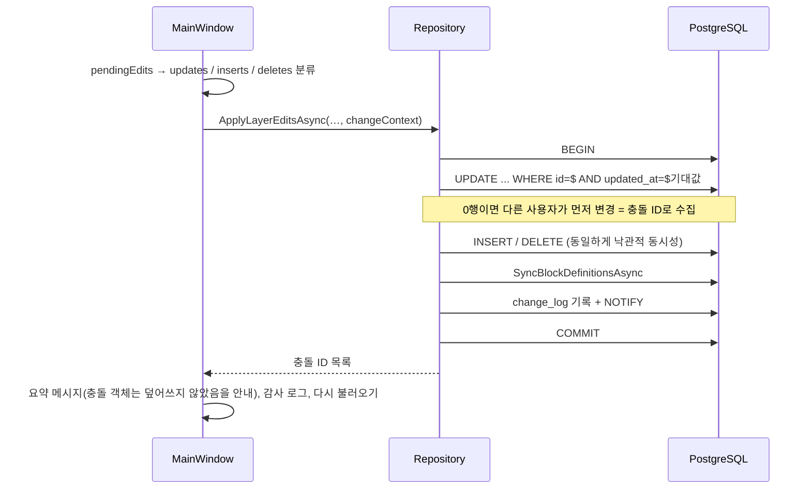
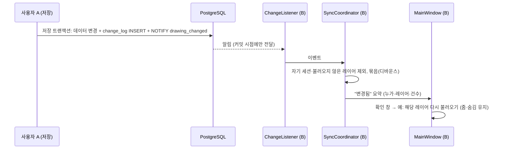

# OmniDT SE (Spatial Editor) 개발 문서

기준일: 2026-10-11 / 브랜치: main / 대상 독자: 이 프로그램을 이어서 개발·유지보수하는 개발자

이 문서는 **구성도(아키텍처), 기능별 세부 구현, 데이터·설정 파일, 테스트와 한계**를 한곳에 정리한다.
기능 목록과 진행 현황은 `DEVELOPMENT_STATUS.md`, 테이블 정의서와 ERD는 `DATABASE_SCHEMA.md`,
라이브러리·동기화 설계의 배경은 `LIBRARY_DESIGN.md`, `SYNC_PLAN.md`를 본다. 이 문서는 그 내용을 코드 구조 관점에서 연결한다.

---

## 1. 제품 개요

CAD(DXF) 도면의 **설비(장비) 블록**을 PostgreSQL/PostGIS(EPSG:5186)에 적재하고, 지도 화면에서 조회·편집·저장하며,
여러 사용자가 같은 데이터를 함께 쓰는 **.NET 8 WPF 공간 데이터 편집기**다.

| 항목 | 내용 |
|---|---|
| 제품명 | OmniDT SE (Spatial Editor). 프로젝트·네임스페이스·설정 폴더는 호환을 위해 `SpatialEditor.*` 유지 |
| 플랫폼 | .NET 8, WPF(`net8.0-windows`), Windows 전용 |
| 데이터 | PostgreSQL + PostGIS, SRID 5186(단위 m) |
| 주요 라이브러리 | NetTopologySuite(형상), Npgsql(DB), netDxf 2023.11.10(DXF 읽기·쓰기) |
| 코드 규모 | 약 1.1만 줄(`MainWindow.xaml.cs`가 약 4,600줄로 가장 큼) |

핵심 개념 두 가지:

- **블록 인스턴스**: DXF의 `INSERT` 하나 = 편집 가능한 객체 하나. 삽입점·회전·축척과 월드 좌표 형상(`geom`, 외곽 `outer_geom`)을 가진다.
- **레이어**: `layer_name` 문자열로 묶인 객체 집합. 별도 레이어 테이블은 없고, 레이어 목록은 두 데이터 테이블에서 집계한다.

---

## 2. 구성도

### 2.1 프로젝트 의존 관계

의존 방향은 항상 위(App) → 아래(Domain)다. Domain은 어떤 프로젝트도 참조하지 않는다.

| 프로젝트 | 책임 | 주요 파일 |
|---|---|---|
| **SpatialEditor.App** | 화면, 사용자 입력, 렌더링, 편집 상태 관리, 동기화 조정 | `MainWindow*.cs/.xaml`, 각 대화상자(`*Window`), `SyncCoordinator`, `AppSettings`, `ShortcutCommand` |
| **SpatialEditor.Domain** | 의존성 없는 모델 | `SpatialFeature.cs`(`SpatialFeature`, `LayerInfo`, `EditableLayerObject`), `Users.cs`(권한 키), `Library.cs`, `ChangeFeed.cs` |
| **SpatialEditor.Geometry** | NTS 기반 점·선·면 생성/검증, 폴리라인→폴리곤 | `GeometryService`, `PolylinePolygonizer` |
| **SpatialEditor.Infrastructure** | DB 접근 전부, 설정 JSON, 비밀번호 해시, 변경 알림 | `PostGisFeatureRepository`, `UserRepository`, `LibraryRepository`, `ChangeFeedRepository`, `ChangeListener`, `PostgresConnectionSettings`, `PasswordHasher` |
| **SpatialEditor.Cad** | DXF ↔ 형상 변환 | `DxfBlockImporter`, `DxfBlockExporter` |

### 2.2 실행 시 구성

- 모든 사용자가 **같은 DB 계정**으로 접속하고, 권한은 앱(`AppUser.Has(...)`)에서 검사한다.
- 서버와의 실시간 통신은 PostgreSQL `LISTEN/NOTIFY`뿐이다. 별도 서버 프로세스는 없다.

### 2.3 메인 창 화면 구성

툴바는 의미가 비슷한 버튼끼리 구분선으로 묶여 있고, 버튼마다 아이콘 아래에 한글 2자 이름표가 붙는다(스타일 `ToolButton`/`ToolToggleButton`, `Resources\Styles.xaml`). 구성은 ① 서버·DXF ② 보기 ③ 선택 ④ 편집 모드·저장·Undo/Redo ⑤ 객체 편집(복제·삭제·그룹·회전·정점·격자) ⑥ 라이브러리·설정이다. 레이어 관련 버튼은 레이어 패널 헤더에 있으므로 툴바에는 두지 않는다.

`MainWindow`는 `partial class`로 나뉜다.

| 파일 | 내용 |
|---|---|
| `MainWindow.xaml` | 메뉴·툴바·3열 본문·상태 표시줄 레이아웃 |
| `MainWindow.xaml.cs` | 로그인/연결, 지도 렌더링, 레이어 패널, 선택, 편집 모드 전체, 저장, DXF Import, 동기화 UI, 미니맵 |
| `MainWindow.Settings.cs` | 단축키 명령 목록, 자동 저장 타이머, 설정 창 연결 |
| `MainWindow.Export.cs` | DXF 내보내기, 레이어 삭제 |
| `MainWindow.Undo.cs` | Undo/Redo 스냅샷, 편집 취소(`CancelEdits`) |
| `MainWindow.Toolbar.cs` | 툴바 전용 버튼(전체 선택, 선택 확대, 회전)과 활성 상태(`UpdateToolbarState`) |

---

## 3. 기능별 세부 구현

### 3.1 서버 연결과 로그인

| 항목 | 구현 |
|---|---|
| 연결 설정 | `PostgresConnectionSettings`(Host/Port/Database/Username/Password 등)를 `%LOCALAPPDATA%\SpatialEditor\postgres-connection.json`에 저장. 시작 시 자동 연결, 실패하면 `ServerConnectionWindow` 표시 |
| 앱 로그인 | `LoginWindow`(ID/비밀번호). 마지막 ID 기억, 비밀번호는 옵션으로 **Windows DPAPI(현재 사용자 범위)**로 암호화해 `LastLoginPasswordProtected`에 저장. 자동 로그인 옵션은 `AppSettings.AutoLogin` |
| 첫 실행 | 사용자가 없으면 같은 `LoginWindow`가 Name/Confirm 입력란을 보여 주는 "첫 관리자 생성" 모드로 전환 |
| 비밀번호 | `PasswordHasher`: PBKDF2-SHA256, 반복 횟수·솔트 포함 문자열 저장. 5회 연속 실패 시 15분 잠금, 임시 비밀번호는 변경 강제 |
| 권한 | `Permissions` 상수(`user.manage`, `library.*`, `drawing.view/edit/delete/export`, `import.dxf`, `audit.view`). `MainWindow.Require(permission, action)`이 검사하고 거부 메시지를 띄움. `ApplyUserState()`가 버튼 활성 상태를 일괄 갱신 |
| 감사 로그 | `AuditAsync(action, entityType, entityId, summary)` → `audit_log`. 로그인·저장·Import·삭제·내보내기·레이어 이름 변경 등 |

로그인 창 디자인: 위쪽에 설비 도면 일러스트(아이콘과 같은 모티브·같은 붉은 계열 그라데이션·격자)를 전부 보이게 두고,
아래쪽 가로 패널에 ID/Password(및 Name/Confirm)를 2열로 배치한다. 컨트롤 이름(`LoginIdTextBox`, `PasswordInput` 등)은 코드와 묶여 있으므로 바꾸지 않는다.

### 3.2 DXF Import (`DxfBlockImporter`)

- **엔티티 변환**(`CreateGeometry`): `Line`, `Polyline2D/3D`, `Point`, `Circle`, `Arc`, `Ellipse`, `Spline`, `Text/MText`(위치 점)를 NTS 형상으로 변환한다. 곡선은 sagitta 허용오차 `flattening`(기본 0.01)에서 분할 수를 계산(`PointsPerFullCircle`, 8~2000 구간)한다. 불룩(bulge) 폴리라인은 최소 반지름 기준으로 분할한다.
- **변환 행렬**: `Matrix2D.FromInsert`가 삽입점·회전·축척을 2D 아핀 행렬로 만들고, 중첩 `INSERT`는 `Combine`으로 합성한다. 순환 참조는 `blockStack`으로 막고 `unsupported_entities`에 기록한다.
- **블록 인스턴스 결과**(`CadBlockInstanceResult`): 실제 선 모음 `ActualGeometry`, 폴리곤화한 외곽 `OuterGeometry`, 속성(`block_name`, `block_handle`, `block_insert_x/y`, `block_rotation_deg`, `block_scale_x/y` 등).
- **외곽 계산**(`CreatePolygonizedOuterGeometry`): NTS `Polygonizer`로 닫힌 영역을 만들고 합집합한다. 닫힌 면이 없으면 **경계 상자로 대체**하고 이유(dangle/cut-edge/invalid-ring 수)를 `outer_geom_fallback_reason`에 남긴다.
- **Equipment 전용 Import**: `Equipment` 레이어의 `INSERT`만 블록 객체로 읽는다(현재 샘플 126개). 툴바의 "Equipment only" 토글로 선택한다.
- **제약**: Import 대상 파일이 `data\SmartLayout.dxf`로 코드에 고정되어 있다(파일 선택 대화상자는 남은 과제).
- **취소·로그**: `CancellationTokenSource`로 취소하면 트랜잭션이 롤백된다. `%LOCALAPPDATA%\SpatialEditor\logs\import-YYYYMMDD.log`에 DXF 대비 DB 수량, 경고, 구간별 소요 시간을 남긴다(`ImportAuditLogger`).

### 3.3 지도 렌더링과 조회

- **좌표 변환**: 로드한 전체 범위(`renderedEnvelope`)를 화면 좌표로 투영(`ProjectToScreen`/`UnprojectFromScreen`)하고, 확대·이동은 `mapScale`/`mapTranslation`(`ScaleTransform`/`TranslateTransform`)을 `MapLayerCanvas`와 `EditableObjectsCanvas`에 같은 `TransformGroup`으로 적용한다.
- **레이어별 단일 Path**: 레이어마다 면/선/점 `StreamGeometry`를 하나씩 만들어 `Path` 3개 이하로 그린다(수만 도형도 가볍다). 선은 둥근 접합·끝(`ApplyRoundStroke`)으로 끊김을 없앤다.
- **고정 화면 두께**: 확대해도 선 굵기가 일정하도록 `baseStrokeWidths[shape] / mapScale`로 `StrokeThickness`를 다시 계산(`UpdateStrokeWidths`, 40ms 디바운스).
- **레이어 선택 로드**: 시작 시 `FindImportedLayersAsync`로 목록만 조회하고 `LayerSelectionWindow`에서 고른 레이어만 불러온다. 선택은 설정(`SelectedLayers`)에 저장한다.
- **선택·강조**: `TrySelectFeatureAt`이 클릭 지점의 객체를 찾고, 블록 인스턴스는 `GetBlockGroups()`로 같은 ID의 모든 조각을 묶어 **블록 전체**를 하나로 선택한다. 강조는 금색 형상(`BuildHighlightGeometry`)을 덧그린다. 숨긴 레이어의 선택 강조는 함께 지운다.
- **선택 강조 스타일**: 색상·두께는 Settings > General > "Selection outline"에서 정한다(`AppSettings.SelectionColor`, `SelectionThickness`, 기본 `#FFD700`/1.5px). `SelectionBrush`/`SelectionThickness`가 조회 모드 강조, 편집 모드 선택 테두리, 점 강조에 공통 적용된다. 확대해도 화면 두께는 일정하다.
- **줌/이동**: 마우스 휠(커서 기준 확대), 가운데 버튼 드래그, Fit/Reset, 선택 객체로 확대(`ZoomToSelection_Click`).

#### 미니맵

- `MiniMapCanvas` 안에 전체 형상을 축소 복제(`RebuildMiniMap`, 레이어 표시 상태 반영)하고, 현재 보이는 범위를 빨간 사각형(`MiniMapViewport`)으로 표시(`UpdateMiniMapViewport`).
- 클릭·드래그 시 `CenterMapOnMiniMapPoint`가 지도 중심을 이동. 재구성/뷰포트 갱신은 `Schedule...`로 한 프레임에 한 번만 실행한다.
- 미니맵과 레이어 목록 사이에 **가로 `GridSplitter`**가 있어 미니맵 높이를 조절할 수 있다(기본 170, 최소 60). 미니맵은 `Viewbox`라 높이에 맞춰 같이 확대된다.

### 3.4 레이어 패널과 스타일

| 기능 | 구현 |
|---|---|
| 표시/숨김 | 행의 체크박스 → `LayerVisibilityChanged`가 `shapesByLayer[layer]`의 `Visibility` 변경, 선택 강조·미니맵 갱신 |
| 쌓임 순서 | 행 드래그(`LayerRow_*`) → `layerZOrder` 갱신, `ApplyLayerOrder`가 `Panel.ZIndex` 적용 |
| 우클릭 메뉴 | 레이어로 확대, 스타일, 이 레이어 편집, 이것만 표시, 숨김, **삭제** (`BuildLayerContextMenu`) |
| 헤더 버튼 | 레이어 불러오기, 새로고침, **삭제**, 모두 표시, 모두 숨김 |

#### 레이어 속성 대화상자 (`LayerStyleWindow` + `ColorEditor`)

- **이름**, **선**(색상·두께 0.25~8px), **채우기**(색상·투명도 0~100%, "선 색과 같게" 체크) 3가지를 한 창에서 바꾼다. 하단 미리보기는 지도와 같은 둥근 접합으로 그린다.
- `ColorEditor`(UserControl)는 팔레트 12색 + RGB 슬라이더 + Hex 입력으로 구성되고 선/채우기 탭이 공유한다. 변경 시 `ColorChanged` 이벤트를 낸다.
- **저장**: `LayerStyleSetting`(`Color`, `Thickness`, `FillColor`, `FillOpacity`)을 레이어 이름 키로 연결 설정 JSON의 `LayerStyles`에 저장한다. `FillColor`가 null이면 선 색을 따른다. 기본 투명도는 기존과 같은 60/255.
- **적용**: `GetLayerFill(layer)`가 채우기 색+투명도를 알파가 있는 `Color`로 만들고, 렌더링(`RenderImportedGeometries`)과 즉시 적용(`ApplyLayerStyle`)이 같은 함수를 쓴다. 스타일만 바꾼 경우 다시 불러오지 않고 도형의 브러시만 교체한다.
- **이름 변경**(`RenameLayerAsync`): 권한 `drawing.edit`, 편집 모드 불가. `LayerExistsAsync`로 중복(대소문자 무시)을 거부하고, `RenameLayerAsync`가 두 테이블의 `layer_name`을 **한 트랜잭션**으로 바꾸며 변경 피드에 옛 이름 삭제·새 이름 갱신을 기록한다. 이후 `LayerStyles`, `layerColors`, 숨김 목록, 레이어 필터의 키를 새 이름으로 옮기고 `ReloadForSyncAsync`로 줌·숨김을 유지한 채 다시 그린다.
- 점 레이어는 채우기 투명도를 쓰지 않고 선 색으로 칠한다. 편집 모드의 윤곽선은 이 설정과 무관하다.

#### 레이어 삭제

- `DeleteLayerAsync`(UI) → `PostGisFeatureRepository.DeleteLayerAsync`: 확인창(기본 No) → 권한 `drawing.delete` → 편집 모드 불가 확인.
- 한 트랜잭션에서 `spatial_features`와 `spatial_block_instances`의 해당 `layer_name` 행(`"(no layer)"`는 NULL)을 삭제하고, 더 이상 쓰이지 않는 `block_definitions`를 정리하며, 전체 레이어 삭제를 변경 피드에 기록한다.
- 이후 레이어 필터·숨김 목록에서 제거하고 다시 불러온다. 복구 기능은 없다.

### 3.5 편집 모드

편집 상태는 두 사전으로 관리한다.

- `editableSourcesById`: 편집 모드 진입 시 DB에서 읽은 **원본**(`EditableLayerObject`).
- `pendingEdits`: 객체별 **현재 상태**(`PendingLayerEdit`: `CurrentGeometry`, `CurrentOuterGeometry`, `Attributes`, `IsNew`, `IsDeleted`, `HasChanges`). 변환을 누적하지 않고 현재 형상을 그대로 들고 있어, 이동·회전·정점 편집을 자유롭게 섞어도 일관성이 유지된다.

**ID 규칙**: `spatial_features`와 `spatial_block_instances`는 각자 ID 시퀀스를 가지므로 충돌을 막기 위해 블록 인스턴스 ID에 상위 비트(`1L << 62`)를 붙여 한 사전에서 같이 쓴다(`EncodeBlockInstanceId`/`Decode...`). 저장 시에만 디코딩해 테이블을 구분한다. 새 객체는 음수 임시 ID(`nextTempId`)를 쓴다.

| 동작 | 구현 |
|---|---|
| 진입 | `EnterEditModeForLayerAsync`: `EnsureSchemaAsync` 후 `FindEditableLayerObjectsAsync` + `FindEditableBlockInstancesAsync`. 툴바 전체 편집은 화면에 보이는 레이어로 한정(`IsInScope`), 해당 레이어의 기본 도형은 숨기고(`ApplyEditMask`) 편집 도형만 그린다 |
| 선택 | 클릭, **Shift/Ctrl+클릭**(토글, `IsAdditiveSelectKeyDown`), **범위 선택**: 빈 곳을 드래그하면(`BeginBoxSelect`/`FinalizeBoxSelect`) 설비(블록 인스턴스)는 외곽선이 박스에 **걸치기만 해도** 선택(`OutlineTouchesRect`, Liang-Barsky 선분-사각형 교차), 그 밖의 큰 객체는 박스 안에 완전히 들어올 때만 선택. Shift/Ctrl을 누르고 그리면 기존 선택에 추가. Ctrl+A 전체 선택. 선택된 객체는 이동·회전·복제·삭제가 모두 한꺼번에 적용된다 |
| 키보드 이동 | **Ctrl+방향키**로 선택 객체를 이동(`TryNudgeFromKey`). 격자 스냅 켜짐: 한 칸(10 단위), 꺼짐: 1 단위, Ctrl+Shift는 10배. 겹침 검사·삽입점 속성 갱신은 드래그 이동과 같다. 텍스트 상자 등에 포커스가 있으면 가로채지 않는다 |
| Undo/Redo | `PushUndo()`가 편집 명령 직전의 `pendingEdits` 스냅샷(`SnapshotPendingEdits`)을 쌓고(최대 100단계), **Ctrl+Z = Undo, Ctrl+R = Redo**. 이동·키보드 이동·회전·복제·삭제·그룹·정점 편집이 모두 대상이다. 편집 모드 진입/종료 시 기록을 비운다 |
| 이동 | 드래그 중에는 도형 점 스냅샷(`editShapeSnapshot`)으로 미리보기, 놓을 때 `FinalizeEditDrag`가 형상을 이동하고 `ApplyPlacementMove`로 `block_insert_x/y` 속성을 같이 갱신. 10mm 격자 스냅 옵션 |
| 회전 | 핸들 클릭 또는 `r`(시계 90°)/`R`(반시계). `AffineTransformation.RotationInstance`(CCW 양수)로 형상 회전, `ApplyPlacementRotation`이 삽입점과 `block_rotation_deg`(0~360 정규화)를 갱신 |
| 복제·삭제 | `DuplicateSelected_Click`(복제본의 `block_handle` 제거), `DeleteSelected_Click` |
| 그룹 | `GroupSelected_Click`: 선택 객체를 하나의 블록으로 묶음. 무게중심을 삽입점, 회전 0, 축척 1로 두고 형상 조각을 모음 |
| 정점 편집 | `ToggleVertexEdit_Click`: 폴리곤 외곽의 정점·중점 핸들, 다른 정점으로의 스냅(`VertexSnapTolerance` 10px). 블록 인스턴스는 정점 편집 불가 |
| 겹침 금지 | `RejectEquipmentOverlap`/`HasEquipmentOverlapBeforeSave`: 장비 외곽(`EquipmentAreas`)이 겹치면 오류를 알리고 이전 위치로 되돌린다. 저장 직전에도 검사 |
| ESC | `CancelEdits`: 진행 중 드래그 취소, 없으면 저장되지 않은 모든 편집을 버리고 저장 상태로 복원(버린 상태도 Undo로 되살릴 수 있다). Edit 메뉴 "Cancel edits"도 같은 동작 |
| 자동 저장 | 설정의 주기(1~120분)마다 `AutoSaveTickAsync` → `SaveEditsAsync(auto: true)`. 겹침이 있으면 건너뜀. 저장 후 다시 불러와 같은 레이어 편집 모드로 복귀 |

**저장**(`SaveEditsAsync` → `PostGisFeatureRepository.ApplyLayerEditsAsync`):

- **낙관적 동시성**: 편집 진입 시 읽은 `updated_at`을 조건으로 UPDATE/DELETE 하고, 영향 행이 0이면 충돌로 보고해 덮어쓰지 않는다. 충돌 없는 나머지는 정상 커밋한다.
- 블록 인스턴스는 속성 JSON의 배치 정보를 변환 컬럼(`insert_x/y`, `rotation_deg`, `scale_x/y`)에 미러링하고, 로컬 좌표 형상 `block_definitions`는 `SyncBlockDefinitionsAsync`(멱등 SQL)가 유지한다. 정의는 **편집되지 않은 인스턴스**의 역변환으로 만든다.

### 3.6 DXF 내보내기 (`DxfBlockExporter`)

- **진입**: 툴바/File 메뉴의 "Export DXF (blocks)..." → `ExportDxf_Click`. 권한 `drawing.export`, 저장 위치는 `SaveFileDialog`.
- **데이터 원천**: 편집 모드면 `CollectEditedInstances`가 **저장 전 현재 편집 상태**(삭제 제외, 새 복제·그룹 포함)를, 아니면 `LoadStoredInstancesAsync`가 DB의 블록 인스턴스(숨긴 레이어 제외)를 사용한다. 삽입점 속성이 없는 객체는 건너뛴다.
- **블록 정의 생성**: 블록 이름별로 `BLOCK`을 하나 만든다. 월드 형상을 블록 로컬 좌표로 되돌리는 변환은 INSERT 변환의 역이다: 평행이동 제거 → 회전 제거 → 축척 나눗셈. 면은 닫힌 `Polyline2D`, 선은 `Polyline2D`, 점은 `Point`. 같은 이름은 **먼저 나온(수정되지 않은) 인스턴스**의 형상을 정의로 쓴다(수정 안 된 객체를 앞에 정렬).
- **블록 속성(ATTRIB)**: 모든 블록 정의에 숨김(Hidden) `ATTDEF` 4개를 넣고 각 `INSERT`에 값을 채운다.

| 태그 | 값 |
|---|---|
| `NAME` | 설비(블록) 이름 |
| `ROTATION` | 회전각(도, CCW, `0.######`) |
| `POS_X` / `POS_Y` | 위치점(삽입점) 좌표 |

  `INSERT` 자체의 삽입점·회전·축척도 네이티브 값으로 같이 기록하므로 CAD에서 그대로 재현된다. 레이어는 설비의 원래 레이어(없으면 `Equipment`), 이름의 금지 문자는 `_`로 치환(`SanitizeName`). DXF 버전은 AutoCAD 2010.
- **검증**: `DxfBlockExporterTests`가 내보낸 파일을 다시 읽어 이름·회전·위치·속성 값과 지오메트리 범위가 복원되는지 확인한다.

### 3.7 블록 라이브러리

- **스키마**: `block_categories`(트리), `block_library`(코드·이름·분류·제조사·모델·상태), `block_library_versions`(형상 해시 포함), `block_ports`(테이블만 존재), 인스턴스의 `library_id`.
- **자동 등록**: Import 후 블록 이름별로 라이브러리 항목을 만들고 인스턴스를 연결한다. 형상 해시로 같은 형상 중복을 막는다.
- **객체에서 등록**: Tools 메뉴 → `LibraryItemWindow`. 같은 형상이 있으면 새로 만들지 않고 연결.
- **라이브러리 창**(`LibraryWindow`): 분류 트리, 검색(코드·이름·제조사·모델), 상태 필터, 썸네일 목록(`GeometryPreview`), 속성, 분류 추가·이름 변경, 항목 편집·삭제(사용 중이면 거부하고 `deprecated` 안내).
- 2단계 이후(라이브러리에서 배치, 정의 편집·게시, 포트 편집, 모델 교체 등)는 미구현 — `LIBRARY_DESIGN.md` 참조.

### 3.8 다중 사용자 동기화

- **기록**: `ChangeFeedRepository.RecordAsync`가 저장·Import·삭제·레이어 이름 변경 때 **같은 트랜잭션에서** `change_log`에 쓰고 `pg_notify`를 보낸다. 롤백되면 알림도 나가지 않는다. 항목은 `ChangeEntry(레이어, 종류, 객체 ID, 작업 I/U/D)`이며 객체 내용은 담지 않는다.
- **수신**: `ChangeListener`가 전용 연결로 `LISTEN`, 끊기면 1·2·5·10·30초 간격으로 재연결. 연결 직후와 60초마다 마지막으로 처리한 변경 번호(`seq`) 이후를 조회해 놓친 변경을 보충한다. 30일이 지난 변경 행은 정리한다.
- **UI**: 편집 모드 중에는 묻지 않고 저장/취소 이후에 묻는다. "아니오"는 상태 표시줄에 "갱신 대기 (N건)"로 남는다. 내 세션의 변경과 불러오지 않은 레이어의 변경은 무시한다.
- 남은 과제: 변경된 객체만 다시 읽는 부분 갱신(`SYNC_PLAN.md` 5단계).

### 3.9 사용자·역할 관리

- `UserManagementWindow`(`user.manage`): 사용자 등록·수정·비활성화·비밀번호 초기화·잠금 해제, 역할 생성과 권한 키 지정(`RoleEditWindow`). 기본 역할: Admin / LibraryManager / Designer / Viewer. **마지막 Admin은 삭제·비활성화할 수 없다.**
- 저장소는 `UserRepository`(`app_users`, `roles`, `role_permissions`, `user_roles`, `audit_log`). 테스트는 `Infrastructure.Tests/UserTests.cs`.

### 3.10 설정과 단축키

| 파일 | 위치 | 내용 |
|---|---|---|
| `postgres-connection.json` | `%LOCALAPPDATA%\SpatialEditor\` | DB 접속 정보, 불러올 레이어, 마지막 로그인 ID/암호화된 비밀번호, 레이어 스타일 |
| `app-settings.json` | 같은 폴더 | 자동 로그인, 비밀번호 기억, 단축키 재정의(명령 ID → 제스처), 자동 저장 사용·주기 |
| `logs\import-YYYYMMDD.log` | 같은 폴더 | Import 감사 로그 |

- **단축키**: `BuildShortcutCommands`가 모든 명령(`file.*`, `edit.*`, `layer.*` …)을 `ShortcutCommand`(id, 분류, 이름, 기본 제스처, 실행, 활성 조건, 메뉴 머리글)로 등록한다. 메뉴 항목의 제스처 표시와 `HandleShortcut`의 입력 처리가 같은 목록을 쓴다. 텍스트 입력 중에는 가로채지 않는다. `SettingsWindow`에서 재지정하면 `AppSettings.Shortcuts`에 저장된다. **새 기능을 추가할 때는 `BuildShortcutCommands`에 명령을 같이 등록한다**(예: `file.export`). 기본 편집 단축키: Ctrl+S 저장, Ctrl+Z Undo, Ctrl+R Redo, Ctrl+D 복제, Del 삭제, Ctrl+G 그룹, Ctrl+A 전체 선택, `r`/Shift+R 회전, Ctrl+방향키 이동(고정), ESC 편집 취소(고정).
- **선택 강조 설정**: General 페이지의 "Selection outline"(`ColorEditor` + 두께 슬라이더 + 미리보기)이 `AppSettings.SelectionColor/SelectionThickness`를 바꾸고, OK 후 즉시 다시 그린다.
- **빌드 번호**: 빌드 시각(`yyyyMMddHHmmss`)을 어셈블리 메타데이터 `BuildStamp`로 넣고 `BuildInfo.Label`이 상태 표시줄·About에 표시한다.

### 3.11 아이콘·테마

- 앱 아이콘(`Resources\app.ico`, 16~256px): 연한 붉은색(SK하이닉스 계열) 둥근 사각형 배경에 격자, 설비 평면도(챔버·로드포트), 선택 그립, 치수선, 활성 그립을 편집하는 연필.
- **About 창**(`AboutWindow`): 프로그램 아이콘(.ico의 가장 큰 프레임)을 배경으로 깔고 아래 반투명 패널에 제품명·버전·빌드 번호·설명을 표시한다.
- 툴바·메뉴 아이콘은 `Resources\Icons.xaml`의 `DrawingImage` 벡터(30종 이상), 공통 스타일은 `Styles.xaml`.

---

## 4. 데이터베이스 요약

전체 정의는 `DATABASE_SCHEMA.md`. 스키마는 앱 시작·기능 첫 사용 시 `EnsureSchemaAsync`가 **멱등 SQL**(`CREATE TABLE IF NOT EXISTS`, `ADD COLUMN IF NOT EXISTS`)로 보장하므로 별도 마이그레이션이 없다.

| 영역 | 테이블 | 정의 위치 |
|---|---|---|
| 도면 | `spatial_features`, `spatial_block_instances`, `block_definitions` | `PostGisFeatureRepository` |
| 라이브러리 | `block_categories`, `block_library`, `block_library_versions`, `block_ports` | `LibraryRepository` |
| 사용자 | `app_users`, `roles`, `role_permissions`, `user_roles`, `audit_log` | `UserRepository` |
| 동기화 | `change_log` | `ChangeFeedRepository` |

주요 리포지토리 메서드(`PostGisFeatureRepository`):

| 메서드 | 용도 |
|---|---|
| `EnsureSchemaAsync` | 스키마 보장 + 블록 정의 동기화 |
| `FindImportedLayersAsync` | 레이어 목록·객체 수 |
| `FindImportedBlockInstanceGeometriesAsync` 외 | 지도 표시용 형상 조회 |
| `FindEditableLayerObjectsAsync` / `FindEditableBlockInstancesAsync` | 편집 대상 조회(`updated_at` 포함) |
| `ApplyLayerEditsAsync` | 편집 저장(낙관적 동시성) |
| `ImportAsync` / `DeleteImportedFileAsync` | Import / DXF 파일 단위 삭제 |
| `DeleteLayerAsync` / `RenameLayerAsync` / `LayerExistsAsync` | 레이어 삭제·이름 변경·중복 확인 |

---

## 5. 테스트와 검증

| 프로젝트 | 내용 |
|---|---|
| `Geometry.Tests` | 형상 생성·검증 |
| `Cad.Tests` | SmartLayout.dxf 가져오기(레이어·Equipment 126개 등), **DXF 내보내기 라운드트립** |
| `Infrastructure.Tests` | 사용자·비밀번호·권한 관련 단위 테스트 |

- 실행: `dotnet test SpatialEditor.sln`. 앱이 실행 중이면 출력 DLL이 잠겨 빌드가 실패하므로 앱을 닫거나 `-o <다른 폴더>`로 빌드한다.
- 라이브러리 이관·동기화 SQL은 임시 PostgreSQL DB로 검증했다(`DEVELOPMENT_STATUS.md` 5절).

**직접 확인하지 못한 것**(코드 컴파일만 확인): 미니맵 스플리터 조작, 레이어 속성 창, 레이어 삭제·이름 변경의 실제 DB 동작, DXF 내보내기 버튼의 실행, 새 로그인·About 창의 화면, 다중 선택(Shift 클릭·걸치기 범위 선택), Ctrl+방향키 이동, Undo/Redo, 새 툴바 배치와 이름표, 선택 강조 설정의 화면 반영. 배포 전에 화면에서 한 번씩 확인해야 한다.

---

## 6. 알려진 한계와 남은 과제

- 모든 사용자가 같은 DB 계정을 쓰므로 권한은 앱 수준이다(DB 수준 격리 없음).
- 연결 설정 JSON의 DB 비밀번호는 평문이다(로그인 비밀번호만 DPAPI). → DPAPI 적용 필요.
- DXF 내보내기: 같은 이름인데 형상이 다른 설비는 한 블록 정의로 통일된다. 레이어 단위 내보내기·내보내기 옵션은 없다.
- 레이어 삭제는 복구 불가. 레이어 이름 변경은 병합을 지원하지 않는다(중복 이름 거부).
- 정점 편집 결과가 상세 벡터(`geom`)에는 반영되지 않는다. 내부 홀이 있는 폴리곤의 정점 편집 미지원.
- Import 경로 고정(`data\SmartLayout.dxf`).
- 동기화는 영향받은 레이어 전체를 다시 불러온다(부분 갱신 미구현). 대형 레이어 성능 미측정.
- 라이브러리 2단계 이후, 단위·부하 테스트 확대.
- `MainWindow.xaml.cs`가 4,600줄이라 편집 모드·렌더링·동기화 UI를 `partial` 파일로 더 나누는 리팩터링이 필요하다.

## 7. 개발 환경 메모

- 빌드: `dotnet build SpatialEditor.sln` (WPF는 Windows 필요). 출력: `SpatialEditor.App\bin\Debug\net8.0-windows`.
- DB 연결은 앱의 서버 연결 창에서 설정한다. 개발용 DB 이름 기본값은 `dinno`.
- 새 UI 기능을 넣을 때의 체크리스트: ① 권한 키 확인(`Require`) ② `ApplyUserState`에서 활성 조건 ③ 메뉴·툴바·`BuildShortcutCommands` 등록 ④ 변경이 DB를 바꾸면 `ChangeFeedRepository.RecordAsync`와 `AuditAsync` 기록 ⑤ 편집 모드·동기화와의 상호작용(`CanReloadLayers`) 확인.
