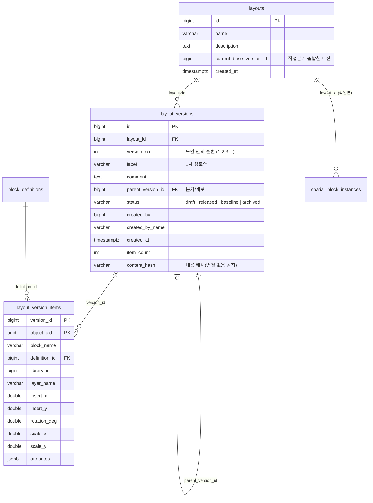
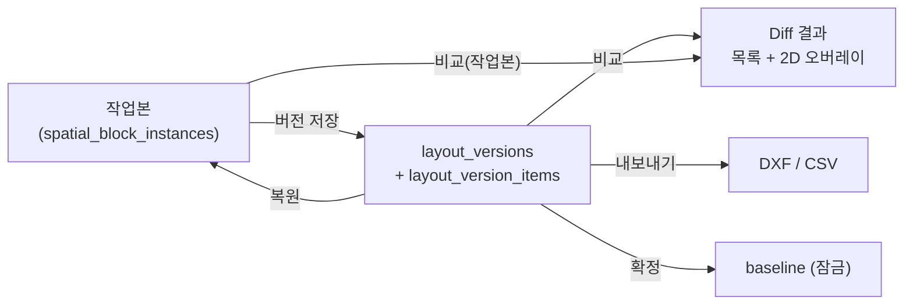

# 설비 배치도면 버전 관리 개발 계획

작성일: 2026-10-11 / 대상: 개발자, 기획 담당 / 상태: **0~5단계 구현 완료 (2026-10-11)** — 16절에 결정과 구현 결과를 정리했다

관련 문서: `DEVELOPMENT_DOCUMENT.md`(현재 구조), `DATABASE_SCHEMA.md`(테이블), `SYNC_PLAN.md`(다중 사용자 동기화), `LIBRARY_DESIGN.md`(라이브러리)

---

## 1. 목표와 범위

설비 배치도면을 편집하면서 생기는 **여러 안(버전)**을 서버에 보관하고, 안끼리 **비교하고, 이전 안으로 되돌리고, 새 안으로 갈라 쓰고, 특정 안을 기준(확정)으로 표시**할 수 있게 한다.

| 하고 싶은 일 | 예 |
|---|---|
| 지금 배치를 하나의 버전으로 남긴다 | "1차 검토안", "고객 수정 반영안" |
| 어떤 버전이 있고 누가 언제 왜 만들었는지 본다 | 버전 목록, 설명, 작성자, 시각 |
| 두 버전의 차이를 본다 | 추가·삭제·이동·회전된 설비를 색으로 표시 |
| 이전 버전으로 돌아간다 | 실수로 망친 배치를 어제 버전으로 복원 |
| 한 버전에서 갈라서 다른 안을 만든다 | A안, B안 병행 검토 |
| 확정 버전을 정한다 | 승인된 기준 배치, 변경 금지 |
| 버전을 DXF로 내보낸다 | 특정 버전의 배치를 CAD로 전달 |

**범위 밖(이번 계획에 넣지 않음)**: 병합(merge)과 충돌 자동 해결, 레이어 단위 부분 버전, 라이브러리 정의 자체의 버전(이미 `block_library_versions`가 있음), 서버 백업·복원.

## 2. 현재 상태와 격차

| 항목 | 지금 | 버전 관리에 필요한 것 |
|---|---|---|
| 도면 데이터 | `spatial_block_instances`(설비), `spatial_features`(그 외) 한 벌. 파일이 달라도 같은 테이블에 섞여 있음 (`source_file` 구분) | 한 도면이 **하나의 작업본 + 여러 버전**을 가져야 함. 도면(배치 단위)이라는 개념이 없음 |
| 객체 식별 | 숫자 `id`(자동 증가). 저장·복원 때 행이 새로 생기면 `id`가 바뀜 | 버전 사이에서 같은 설비를 알아보는 **불변 식별자** |
| 변경 이력 | `change_log`(누가·어느 레이어·몇 건·I/U/D)만 있고 **내용 없음**, 30일 후 정리 | 버전 시점의 **내용 전체** |
| 편집 단위 | 저장 = 변경 묶음 하나. Undo/Redo는 메모리상 편집 중에만 | 저장과 별개로 **의미 있는 시점**을 이름 붙여 남김 |
| 권한 | `drawing.view/edit/delete/export` | 버전 생성·복원·삭제·확정 권한 |
| 동기화 | 저장하면 다른 사용자에게 변경 알림 | 복원·확정 시에도 알림 |
| DXF 내보내기 | `DxfBlockExporter`가 편집 상태/저장된 상태를 내보냄 | 버전 스냅샷을 내보내는 입구 |

## 3. 용어

| 용어 | 뜻 |
|---|---|
| **도면(Layout)** | 버전을 관리하는 배치도면 단위. 예: "A동 2층 설비 배치" |
| **작업본(Working copy)** | 지금 화면에서 편집하고 저장하는 살아 있는 데이터. 현재의 `spatial_block_instances` |
| **버전(Version)** | 작업본의 한 시점을 통째로 복사해 둔 **불변 스냅샷** |
| **버전 저장(Commit)** | 작업본을 새 버전으로 남기는 동작 |
| **복원(Restore)** | 버전의 내용을 작업본에 되살리는 동작 |
| **분기(Branch)** | 한 버전에서 시작하는 별도 계열(A안/B안) |
| **확정(Baseline)** | 승인된 기준 버전. 잠가서 수정·삭제 불가 |

## 4. 핵심 설계 방식

### 4.1 방식 비교와 권장

| | A. 스냅샷 복사 (권장) | B. 변경 내용(델타) 저장 | C. 이벤트 소싱 |
|---|---|---|---|
| 저장 방식 | 버전마다 설비 전체를 복사 | 이전 버전과의 차이만 저장 | 모든 편집 동작을 로그로 저장해 재생 |
| 장점 | 단순, 빠른 조회·내보내기, 복원이 쉬움, 비교는 두 스냅샷 조인 | 용량 작음 | 가장 세밀한 이력 |
| 단점 | 용량(버전 수 × 설비 수) | 복원·조회에 델타 누적 계산, 구현 복잡 | 가장 복잡, 현재 구조와 거리가 큼 |
| 이 프로젝트 적합도 | **높음** — 설비 약 126개 규모, 설비당 행 1개. 100버전이어도 1만 행대 | 중간 | 낮음 |

**결정: A(스냅샷 복사).** 형상(`geom`)은 용량이 크므로 **정의(`block_definitions`) + 변환값(삽입점·회전·축척)**만 버전에 저장하고, 월드 형상은 필요할 때 계산하거나 캐시로 둔다(4.3 참조). 용량이 문제 되면 형상 해시 기반 중복 제거로 개선한다.

### 4.2 객체 식별자(`object_uid`) — 가장 먼저 해야 할 기반 작업

버전 비교는 "같은 설비인지"를 알아야 가능하다. 지금 `id`는 복원·재삽입 시 바뀐다.

- `spatial_block_instances`에 **`object_uid UUID`**(불변, 기본 `gen_random_uuid()`)를 추가한다.
- 복제는 새 uid, 그룹은 새 uid, 이동·회전은 uid 유지.
- 버전 스냅샷 행은 같은 `object_uid`를 가진다. 복원할 때도 uid를 유지해서 이력과 이어진다.
- 기존 행은 마이그레이션에서 uid를 채운다(`EnsureSchemaAsync`의 멱등 SQL).

### 4.3 데이터 모델 (안)



설계 메모:

- `layout_version_items`에는 `geom`을 **저장하지 않는 것**을 기본으로 한다. 형상은 `definition_id`의 로컬 형상에 변환(`ST_Affine`)을 적용해 구한다(`SyncBlockDefinitionsAsync`가 이미 같은 수식을 쓴다). 정의가 나중에 바뀌어도 과거 버전의 형상이 변하지 않게 하려면 **정의도 버전 시점으로 고정**해야 한다 → 4.4.
- 일반 객체(`spatial_features`: 레이어 외곽선 등)는 설비 배치의 대상이 아니므로 **1차는 설비(블록 인스턴스)만 버전 관리**한다. 필요하면 2차에서 `layout_version_features`를 추가한다. (7절 결정 필요 ②)
- `status = baseline`인 버전은 수정·삭제를 막는다(트리거 또는 앱 규칙 + DB 제약).
- 작업본에는 `layout_id`를 추가한다. 현재는 도면이 하나뿐이므로 마이그레이션에서 기본 도면 하나를 만들어 연결한다.

### 4.4 블록 정의 고정 문제

설비 모양(`block_definitions.local_geom`)이 나중에 바뀌면, 정의를 참조하는 과거 버전의 모양이 같이 바뀌어 버린다. 선택지:

| 안 | 내용 | 평가 |
|---|---|---|
| ① 정의 불변화 (권장) | 정의 행은 수정하지 않고 모양이 바뀌면 **새 정의 행**을 만든다. 버전은 정의 id를 참조 | 단순. 현재 `block_definitions`는 `(source_file, block_name)` 유일이라 제약 변경 필요 |
| ② 버전에 정의 복사 | 버전마다 사용한 정의를 별도 보관 | 용량 증가, 중복 |
| ③ 형상까지 버전 항목에 복사 | 항목에 `geom` 저장 | 가장 단순하나 용량 큼 |

**권장 ①.** 단, 1단계(정의가 사실상 바뀌지 않는 현재 운영 방식)에서는 ③을 임시 채택해 먼저 동작을 확인하고, 용량이 문제 되면 ①로 옮기는 단계적 접근도 가능하다.

## 5. 기능 정의

### 5.1 버전 저장

- **입구**: 툴바 `버전`(저장), 메뉴 Version → Save version…, 편집 모드의 저장 직후 "버전으로도 남기시겠습니까?" 선택 옵션.
- **입력**: 이름(label, 필수), 설명(comment, 선택).
- **조건**: 작업본에 **저장되지 않은 편집이 없어야** 한다(있으면 먼저 저장하도록 안내). 장비영역 겹침이 있으면 경고(저장은 허용할지 결정 필요).
- **동작**: 한 트랜잭션에서 작업본 설비를 `layout_version_items`로 복사, `content_hash` 계산. **직전 버전과 내용 해시가 같으면** "변경 없음"으로 안내하고 만들지 않는다.
- **번호**: 도면별 순번 `version_no`(1, 2, 3…).

### 5.2 버전 목록·이력

- 버전 창(Version Manager): 번호, 이름, 상태, 작성자, 시각, 설비 수, 부모 버전, 설명. 정렬·검색.
- 계보 보기: 부모-자식 관계를 트리로 표시(분기가 있을 때 의미가 생김).
- 현재 작업본이 어느 버전에서 출발했는지, 그 뒤 **수정되었는지**(작업본 해시 ≠ 기준 버전 해시)를 상태 표시줄과 창 제목에 표시: 예 `A동 2층 — v5 기반 (수정됨)`.

### 5.3 버전 비교 (Diff)

`object_uid`로 두 버전(또는 작업본)을 맞대어 분류한다.

| 분류 | 판정 | 2D 뷰 표시 색(안) |
|---|---|---|
| 추가 | B에만 있음 | 초록 |
| 삭제 | A에만 있음 | 빨강(점선) |
| 이동 | 삽입점이 다름(허용오차 이내는 같다고 봄) | 주황 + 이동 방향선 |
| 회전 | 회전각이 다름 | 보라 |
| 모양 교체 | `definition_id`/`block_name`이 다름 | 파랑 |
| 속성 변경 | 속성 JSON이 다름 | 회색 표식 |
| 변경 없음 | 모두 같음 | 기본색 연하게 |

- 결과는 **목록**(분류별 건수, 설비 이름, 이전/이후 값)과 **2D 뷰 오버레이**로 같이 본다. 목록 항목을 누르면 해당 설비로 확대.
- 비교 대상: 버전↔버전, 버전↔작업본.
- SQL 한 번(`FULL OUTER JOIN ON object_uid`)으로 계산하고, 오버레이 형상은 필요한 설비만 읽는다.

### 5.4 복원

- **복원 = 작업본을 버전 내용으로 되돌림.** 안전을 위해 복원 전 **현재 작업본을 자동으로 새 버전("복원 전 자동 저장")으로 남긴다**(수정된 경우). 이렇게 하면 복원도 되돌릴 수 있다.
- 복원은 한 트랜잭션: 작업본의 설비를 삭제하고 버전 항목으로 다시 만든다(`object_uid` 유지). 변경 피드에 레이어 단위 변경을 기록해 다른 사용자에게 알린다.
- 편집 모드 중에는 복원할 수 없다(저장 또는 취소 후).
- 다른 사용자가 편집 중이면 경고(그 사용자의 저장은 충돌로 처리됨 — `updated_at` 낙관적 동시성을 그대로 활용).

### 5.5 분기

- 버전 하나를 골라 "여기서 새 안 만들기" → 작업본을 그 버전으로 복원하면서 `parent_version_id`를 그 버전으로 둔 새 계열을 시작한다.
- 1차는 **도면 하나에 작업본 하나**(안 전환은 복원으로 처리)로 단순화한다. A/B안을 동시에 각자 작업본으로 두려면 도면(Layout)을 안마다 따로 만드는 방식을 쓴다(= 복제 도면). (7절 결정 필요 ①)

### 5.6 확정(Baseline)과 잠금

- 권한이 있는 사용자가 버전을 `baseline`으로 지정하면 수정·삭제 불가. 도면당 baseline은 하나(이전 baseline은 `released`로 내려감).
- `archived`는 목록에서 숨기되 삭제하지 않는다.
- 삭제는 `draft`/`released`만 가능하고, 다른 버전의 부모이면 거부(또는 자식을 조부모에 이어 붙이기).

### 5.7 버전 내보내기

- 버전 관리자 창에서 버전을 골라 **DXF 내보내기**(기존 `DxfBlockExporter` 재사용). 이름·회전·위치 속성에 **버전 이름/번호**를 추가 속성(`VERSION`)으로 넣는 옵션.
- 비교 결과(변경 목록)를 CSV로 내보내기.

## 6. 화면 설계

### 6.1 툴바·메뉴

기존 6그룹 툴바에 **"버전" 그룹** 1개를 추가한다(한글 2자 이름표 규칙 유지).

| 이름표 | 기능 | 비고 |
|---|---|---|
| `버전` | 버전 저장 | Ctrl+Shift+S 제안 |
| `이력` | 버전 관리자 창 열기 | 목록·비교·복원·확정 |
| `비교` | 선택한 두 버전(또는 작업본) 비교 모드 | 2D 뷰에 diff 오버레이 |
| `복원` | 선택 버전으로 복원 | 이력 창 안에서도 가능 |

메뉴: 새 Version 메뉴(Save version…, Version manager…, Compare…, Restore…, Set baseline…, Export version as DXF…). 모든 명령은 `BuildShortcutCommands`에 등록해 단축키 설정 창에 나타나게 한다.

### 6.2 버전 관리자 창

```
┌ Version Manager ─ A동 2층 ─────────────────────────────────────┐
│ [검색…] [상태 ▼]                         [새 버전] [비교] [복원]│
├────────────────────────────────────────────────────────────────┤
│ #  이름              상태      작성자  시각        설비  부모   │
│ 7  고객 수정 반영안   draft     kim     10-11 14:20  126   v6   │
│ 6  2차 검토안        released  lee     10-10 17:05  124   v5   │
│ 5  1차 확정(기준)    baseline  lee     10-09 11:30  120   v3   │
│ …                                                              │
├────────────────────────────────────────────────────────────────┤
│ 선택: v6 → v7 비교 결과   추가 2 · 삭제 0 · 이동 5 · 회전 1     │
│  · EQ-A  이동 (120.0,30.0)→(125.0,30.0)   · EQ-C  회전 0°→90°   │
│                       [2D 뷰에서 보기]  [DXF 내보내기] [CSV]    │
└────────────────────────────────────────────────────────────────┘
```

### 6.3 2D 뷰 비교 모드

- 비교 모드에서는 편집을 막고(읽기 전용) 변경 종류별 색으로 표시한다. 범례를 하단에 둔다.
- 우측 속성 패널에는 선택한 설비의 **이전/이후 값**을 나란히 보여 준다.
- 나가기: ESC 또는 `비교` 버튼 다시 클릭.

### 6.4 상태 표시

- 상태 표시줄에 "v7 기반 · 수정됨" 표시. 클릭하면 버전 관리자 창.
- 확정(baseline) 버전과 다른 상태로 편집 중이면 눈에 띄는 표시.

## 7. 결정 필요 사항 (기본값은 권장안)

| # | 질문 | 권장 기본값 | 영향 |
|---|---|---|---|
| ① | 한 도면에서 A안/B안을 **동시에 따로 편집**해야 하는가? | 아니오(복원으로 전환). 필요하면 도면을 복제 | 예이면 `layout_id`별 작업본 UI·편집 로딩 전체를 바꿔야 해서 일정이 크게 늘어남 |
| ② | 버전 대상이 **설비(블록)만**인가, 레이어 외곽선 등 일반 객체도 포함인가? | 설비만(1차) | 포함하면 `layout_version_features` 테이블 추가 |
| ③ | 버전 저장은 **수동만**인가, 편집 저장마다 **자동 버전**도 남길까? | 수동 + "복원 전 자동 저장"만. 자동 저장 버전은 후순위 | 자동이면 용량·목록 정리 정책 필요 |
| ④ | 누가 버전 저장·복원·확정할 수 있는가? | 저장: `drawing.edit` 이상, 복원: `drawing.edit`, 확정: 별도 `drawing.version.baseline` | 권한 키 추가 |
| ⑤ | 버전 **삭제**를 허용하는가? | `draft`만 허용, 확정·부모 버전은 불가 | 이력 보존 정책 |
| ⑥ | 형상까지 버전 항목에 복사할까(4.4 ③) 정의를 불변화할까(① )? | 1단계는 ③, 2단계에서 ① | 용량·정합성 |
| ⑦ | 복원 시 다른 사용자의 편집 중 작업은? | 경고 후 진행, 그쪽 저장은 충돌 처리 | 필요 시 도면 잠금 추가 |
| ⑧ | 보관 기간 | 무기한(용량 점검 후 결정) | 정리 작업 필요 여부 |

## 8. 구현 구조

| 영역 | 변경 | 위치 |
|---|---|---|
| Domain | `LayoutInfo`, `LayoutVersion`, `VersionItem`, `VersionDiff`(분류 enum), 권한 키 `drawing.version.*` | `SpatialEditor.Domain/Versions.cs`, `Users.cs` |
| Infrastructure | `VersionRepository`: `EnsureSchemaAsync`, `CreateVersionAsync`, `ListVersionsAsync`, `GetItemsAsync`, `DiffAsync`, `RestoreAsync`, `SetStatusAsync`, `DeleteAsync` | `SpatialEditor.Infrastructure/VersionRepository.cs` |
| 스키마 | `object_uid` 추가·채우기, `layouts`/`layout_versions`/`layout_version_items` 생성 | `PostGisFeatureRepository.EnsureSchemaAsync`, 새 repository |
| 변경 피드 | 엔티티 종류 `version` 추가, 복원은 레이어 단위 `Update` 기록 | `ChangeFeedRepository` |
| Cad | 버전 항목 → `CadExportInstance` 변환, `VERSION` 속성 옵션 | `DxfBlockExporter` |
| App | `VersionManagerWindow`, `SaveVersionWindow`, 비교 오버레이, 툴바 그룹, 메뉴, 단축키 | `MainWindow.Versions.cs`(부분 클래스), `MainWindow.xaml`, `MainWindow.Settings.cs` |
| 문서 | `DATABASE_SCHEMA.md`, `DEVELOPMENT_DOCUMENT.md`, 사용자 매뉴얼 | 단계 완료 시 갱신 |

핵심 흐름:



## 9. 개발 단계

| 단계 | 내용 | 완료 기준 | 크기 |
|---|---|---|---|
| **0. 기반** | `object_uid` 추가·마이그레이션, 복제·그룹·복원 경로에서 uid 처리, 기본 도면 `layouts` 생성, 권한 키 추가 | 기존 데이터에 uid가 채워지고, 저장·복제·그룹 후에도 uid 규칙이 지켜진다. 기존 테스트 통과 | S |
| **1. 버전 저장·목록** | `layout_versions`/`items`, 버전 저장(해시로 변경 없음 감지), 버전 관리자 창(목록·상세), 툴바 `버전` `이력` | 두 번 저장하고 목록에서 두 버전과 설비 수·작성자가 보인다. 변경 없이 저장하면 안내 | M |
| **2. 비교** | Diff SQL, 결과 목록, 2D 뷰 오버레이(색·범례), 속성 패널 이전/이후 | 설비를 이동·회전·삭제·추가한 뒤 버전과 비교하면 분류별로 정확히 나온다 | M |
| **3. 복원** | "복원 전 자동 저장", 트랜잭션 복원, 변경 피드·동기화 알림, 편집 모드 차단 | 복원 후 2D 뷰가 해당 버전과 같고(uid 동일), 다른 사용자에게 갱신 알림이 간다. 복원도 Undo(이전 자동 버전으로 복원) 가능 | M |
| **4. 확정·잠금·삭제** | 상태 전이(draft→released→baseline→archived), 확정 잠금, 삭제 규칙, 상태 표시줄 표시 | 확정 버전은 수정·삭제가 거부된다 | S |
| **5. 내보내기·분기** | 버전 DXF/CSV 내보내기, 부모 계보 트리 표시, "여기서 새 안" | 버전을 DXF로 내보내 CAD에서 같은 배치가 보인다 | S~M |
| **6. 정리·확장(선택)** | 정의 불변화(4.4 ①)와 용량 최적화, 일반 객체 버전화, 자동 버전, 보관 정책 | 용량 측정 후 필요한 것만 진행 | 선택 |

권장 진행: **0 → 1 → 2 → 3**을 한 묶음(핵심 기능)으로 먼저 내고, 4·5는 사용자 의견을 받은 뒤 진행. 크기 S는 며칠, M은 1~2주 안팎의 상대적 규모이며 정확한 일정은 7절 결정 후 확정한다.

## 10. 동시성·정합성

- **버전 저장 시점의 일관성**: 저장 트랜잭션은 `REPEATABLE READ`(스냅샷)로 읽어, 도중에 다른 사용자가 저장해도 한 시점의 내용만 복사한다.
- **복원과 저장 충돌**: 복원은 작업본 행을 다시 만들기 때문에 `updated_at` 기반 낙관적 동시성으로 다른 사용자의 미저장 편집은 저장 때 충돌 처리된다(덮어쓰지 않음). 복원 직후 다른 세션에는 "서버 데이터가 변경되었습니다" 알림이 간다.
- **idempotent 스키마**: 모든 DDL은 `IF NOT EXISTS`/`ADD COLUMN IF NOT EXISTS`로 `EnsureSchemaAsync`에서 처리(현재 방식 유지).
- **삭제 연쇄**: 도면 삭제 시 버전·항목이 같이 삭제되도록 FK `ON DELETE CASCADE`. `DeleteImportedFileAsync`/`DeleteLayerAsync`가 작업본 설비를 지울 때 **버전은 영향을 받지 않아야** 한다(버전은 독립 스냅샷).

## 11. 성능·용량

- 설비 126개 × 버전 100개 ≈ 1.3만 행(항목당 수백 바이트) → 용량 문제 없음. 설비 수천 개 × 수백 버전이면 수백만 행이므로 `(version_id, object_uid)` 기본키와 `(layout_id, version_no)` 인덱스를 둔다.
- 비교는 두 버전을 `object_uid`로 조인하므로 인덱스만 있으면 수천 건도 즉시.
- 형상을 복사하는 임시 방식(4.4 ③)을 쓰면 용량이 `geom` 크기에 비례한다. 100버전 시점에 실제 용량을 측정해 정의 불변화로 전환 여부를 정한다.

## 12. 테스트 계획

| 종류 | 내용 |
|---|---|
| 단위 | Diff 분류 로직(추가·삭제·이동·회전·모양·속성, 허용오차), 내용 해시 안정성, 상태 전이 규칙, 버전 번호 채번 |
| 통합(임시 PostgreSQL) | 마이그레이션 멱등성, 버전 저장→목록→복원 후 내용 동일, 복원 전 자동 버전, 확정 버전 변경 거부, 작업본 삭제가 버전에 영향 없음, 동시 저장 두 건의 번호 충돌 없음 |
| UI(수동 점검표) | 비교 오버레이 색·범례, 편집 모드 차단, 복원 후 알림, 툴바 비활성 조건 |
| 회귀 | 기존 저장·동기화·내보내기·Undo/Redo가 `object_uid` 추가 후에도 동작 |

## 13. 위험과 대응

| 위험 | 대응 |
|---|---|
| uid 도입이 기존 저장 경로(복제·그룹·정점·Import)를 깨뜨림 | 0단계에서 uid 규칙을 단위 테스트로 고정, 기존 테스트 전부 재실행 |
| 복원이 다른 사용자의 작업을 날림 | 복원 전 자동 버전, 경고 창, 낙관적 동시성, 필요 시 도면 잠금 추가 |
| 모양이 바뀐 정의 때문에 과거 버전이 달라 보임 | 4.4 대응 — 초기엔 형상 복사, 이후 정의 불변화 |
| 도면(Layout) 개념 도입 범위가 커짐 | 1차는 기본 도면 1개로 고정, 다중 도면 UI는 후순위 |
| 버전이 늘어 목록이 복잡 | 상태 필터, 검색, 보관(archive), 부모 계보 접기 |
| 비교 오버레이 성능 | 변경된 설비만 읽어 그림, 변경 없는 설비는 기본 렌더 재사용 |

## 14. 산출물

- 코드: `VersionRepository`, 도메인 모델, 버전 관리자·저장 창, 비교 오버레이, 툴바 그룹과 메뉴, 단축키
- DB: 새 테이블 3개 + 컬럼 추가(멱등 SQL)
- 테스트: 단위·통합 (12절)
- 문서: `DATABASE_SCHEMA.md`(ERD 갱신), `DEVELOPMENT_DOCUMENT.md`(3장에 "버전 관리" 절 추가), 사용자 매뉴얼에 "버전 관리" 장 추가

## 15. 다음 행동

1. 7절 결정 ①~⑧에 답한다. (특히 ① 동시 A/B안, ② 대상 범위, ③ 자동 버전)
2. 확정 후 **0단계(`object_uid` 기반 작업)**부터 착수한다.
3. 1~3단계 구현 중 화면 확인을 위한 시연 시나리오(설비 3개 이동 → 버전 저장 → 비교 → 복원)를 함께 정한다.

## 16. 확정된 결정과 구현 결과 (2026-10-11)

7절의 ①~⑤에 모두 **허용(보관 기간 무제한)**으로 답해 다음처럼 구현했다.

| # | 결정 | 구현 |
|---|---|---|
| ① 도면별 A/B안 동시 편집 | 허용 | **도면(Layout) 여러 개**. 작업본 테이블 두 개에 `layout_id`를 추가하고 모든 조회·저장·삭제·가져오기가 `PostGisFeatureRepository(connectionString, layoutId)`의 도면 안에서만 동작한다. 버전에서 "새 도면으로 분기"하면 그 버전의 복사본이 새 도면의 작업본이 된다. 변경 알림(`change_log`)도 도면별로 구분된다 |
| ② 일반 객체 포함 | 허용 | 설비(블록 인스턴스)와 일반 객체(`cad_block`, `dxf_layer`) 모두 스냅샷·비교·복원 대상. 테이블 `layout_version_blocks`, `layout_version_features` |
| ③ 자동 버전 | 허용 | 편집 저장(자동 저장 포함)마다 `kind=auto` 버전을 남긴다(내용이 같으면 건너뜀). 설정 > General에서 끌 수 있다. 복원 직전 상태는 `pre-restore` 버전으로 남긴다 |
| ④ 권한 | 모두 허용 | 새 권한 키를 만들지 않고 기존 키를 쓴다: 조회·비교·내보내기 = `drawing.view`/`drawing.export`, 저장·복원·분기·확정·삭제 = `drawing.edit` |
| ⑤ 삭제·보관 | 허용·무제한 | 확정(baseline)이 아닌 버전은 삭제 가능(자식은 부모에 이어 붙임). 보관 기간 정리 작업 없음 |

**4.4 결정(형상 보관)**: 1단계 방식(③)을 채택해 버전 항목에 `geom`/`outer_geom`을 그대로 복사한다. 정의 불변화(①)는 용량 측정 후 판단(6단계 선택 사항).

### 구현한 것

| 단계 | 구현 내용 | 위치 |
|---|---|---|
| 0 기반 | `object_uid`(불변 UUID)와 `layout_id`를 작업본 두 테이블에 추가, 기본 도면(id 1) 생성, 기존 데이터 자동 이관(멱등 SQL, 앱이 로그인 직후 실행) | `PostGisFeatureRepository.EnsureSchemaAsync` |
| 1 저장·목록 | 버전 저장(`REPEATABLE READ`, 내용 해시로 "변경 없음" 감지, 도면별 번호 `pg_advisory_xact_lock`으로 직렬화), 버전 관리자 창, 상태 표시줄 "v5 기반 (수정됨)" | `VersionRepository`, `VersionManagerWindow`, `MainWindow.Versions.cs` |
| 2 비교 | `object_uid` 기준 비교(추가·삭제·이동·회전·모양 교체·속성), 목록 + 2D 뷰 오버레이(색·범례·이동 화살표), CSV 내보내기 | `VersionDiffer`(Domain, 단위 테스트), `ShowDiffOverlay` |
| 3 복원 | 복원 전 자동 버전, 한 트랜잭션 교체(uid 유지), 변경 피드로 다른 사용자에게 알림 | `RestoreVersionAsync` |
| 4 확정·삭제 | 상태 draft/released/baseline/archived, 도면당 baseline 하나, baseline은 이름 변경·삭제 불가, 삭제 시 자식 재연결 | `SetStatusAsync`, `DeleteVersionAsync` |
| 5 내보내기·분기 | 버전을 DXF로 내보내기(`DxfBlockExporter` 재사용), 새 도면으로 분기, 도면 관리 창(열기·새로 만들기·이름 변경·삭제) | `CreateLayoutFromVersionAsync`, `LayoutManagerWindow` |

화면: 툴바 "버전" 그룹(버전·이력·비교·도면), 메뉴 Version, 상태 표시줄의 도면/버전 상태, 설정의 자동 버전 옵션. 단축키: Ctrl+Shift+S(버전 저장).

### 검증

- 단위 테스트(`VersionDifferTests`, 6건): 추가·삭제·이동·회전·허용오차·각도 감김·속성/배치 속성 구분.
- 통합 테스트(`VersionRepositoryTests`, 환경 변수 `SPATIAL_TEST_CONNECTION`이 있을 때만 실행, 임시 PostGIS DB로 확인): 저장 → 변경 없음 거부 → 이동 후 비교 → 두 번째 버전 → 복원(uid 유지, 복원 전 자동 버전) → 분기(독립 편집) → baseline 보호와 이동 → 삭제 재연결 → 도면 삭제, 도면별 레이어 삭제·이름 변경·변경 알림 분리, 구버전 DB 이관(uid 고유).
- 모든 창이 실제로 로드되고(리소스 오류 없음) 메인 화면의 렌더링을 이미지로 확인했다.

### 남은 것 / 알려진 한계

- **앱을 띄워 실제 DB로 버전 저장·비교·복원을 조작하는 시험은 하지 못했다**(임시 DB에서는 저장소 계층만 검증).
- 정의 불변화와 형상 중복 제거(용량 최적화), 버전 보관 기간 정리, 도면 잠금(복원 중 다른 사용자 차단), 병합은 구현하지 않았다.
- 2D 비교 오버레이는 로드된 레이어 범위를 기준으로 그리며 편집 모드에서는 쓸 수 없다(해제됨).
- 한 사용자가 도면 A에서 작업하는 동안 다른 사용자가 도면 B를 열면 서로의 알림은 오지 않는다(의도된 동작).
